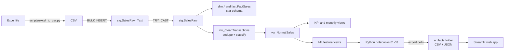

# Retail Intelligence: SQL Server Warehouse + Machine Learning on Online Retail II

An end-to-end analytics project on two years of real e-commerce transactions: raw data is loaded and cleaned in **SQL Server**, modelled as a **star schema**, and used in **Python** to answer three business questions with machine learning.

| # | Business question | Technique | Notebook |
|---|---|---|---|
| 1 | Which types of customers do we have? | RFM features + K-Means | [`01_customer_segmentation`](notebooks/01_customer_segmentation.ipynb) |
| 2 | Who will buy in the next 30 days? | Logistic Regression, Random Forest, XGBoost | [`02_purchase_prediction`](notebooks/02_purchase_prediction.ipynb) |
| 3 | How much of each top product will sell per day? | Lag/rolling features + Random Forest, XGBoost | [`03_demand_forecasting`](notebooks/03_demand_forecasting.ipynb) |

The results are also packaged as an interactive **Streamlit web app** (customer lookup, purchase-probability calculator, forecast explorer); see [Deployment](#deployment).

## Dataset

[Online Retail II](https://doi.org/10.24432/C5CG6D) (UCI Machine Learning Repository, CC BY 4.0): all transactions of a UK-based online gift-ware retailer between **2009-12-01 and 2011-12-09**, about **1.07 million** transaction lines. Many customers are wholesalers. The data is *not* stored in this repository; see [How to run](#how-to-run).

## Architecture



**Two paths leave the staging table.** The star schema (`dim`/`fact`) is the dimensional model for reporting and BI tools. The analytical and ML views read from the *cleaned* staging data (`vw_CleanTransactions`), which is where de-duplication and transaction classification happen. See [Limitations](#limitations-and-next-steps) for how these could be merged.

### Star schema

```
                     DimCustomer
                          |
 DimProduct ------- FactSales ------- DimDate
                          |
                     DimCountry
```

* **Grain of `FactSales`:** one product line within one invoice. `InvoiceNo` repeats, so it is not the primary key.
* **Surrogate keys** (`ProductKey`, `CustomerKey`, ...) decouple the warehouse from source codes.
* **"Unknown" members (key 0)** keep transactions without a `CustomerID` instead of dropping them.
* `Revenue` is a persisted computed column (`Quantity * UnitPrice`).

## Data cleaning

The raw table mixes real sales with returns, fees and accounting entries. `vw_CleanTransactions` removes exact duplicate rows and labels every row with a `TransactionType` (first matching rule wins):

| TransactionType | Rule |
|---|---|
| Accounting Adjustment | StockCode `B` ("Adjust bad debt") |
| Adjustment / Financial Charge / Fee / Commission | StockCodes `ADJUST*`, `BANK CHARGES`, `AMAZONFEE`, `CRUK` |
| Shipping / Postage / Discount | `C2`, `POST`/`DOT`, `D` |
| Manual Transaction / Sample / Gift Voucher | `M`, `S`, `gift_*` |
| Cancellation / Return | `C` invoice, negative quantity, positive price |
| Inventory Adjustment | negative quantity, zero price |
| Zero-Price Special Transaction | positive quantity, zero price |
| **Normal Product Sale** | everything else (used for all KPIs and models) |

The exploration that led to these rules is in [`sql/04_data_quality_checks.sql`](sql/04_data_quality_checks.sql).

## Results

*Numbers below come from the original run of the project; re-running the notebooks refreshes them.*

### 1. Customer segmentation (5,852 customers, K = 4)

| Segment | Customers | Share | Median recency (days) | Median orders | Median spend |
|---|---:|---:|---:|---:|---:|
| Active High-Value | 1,068 | 18.3 % | 17 | 13 | 5,689 |
| Recent Mid-Value | 1,788 | 30.6 % | 40 | 5 | 1,385 |
| Inactive Low-Mid-Value | 1,710 | 29.2 % | 360.5 | 2 | 571 |
| Inactive Very-Low-Value | 1,286 | 22.0 % | 358.5 | 1 | 172 |

K = 2 has the best silhouette score (0.37) but only splits active from inactive customers. K = 4 (silhouette 0.23) was chosen because it gives four distinct, actionable groups. The notebook ends with a recommended action per segment (proposals, not tested campaigns).

### 2. Purchase prediction (5,700 customers, 25.9 % bought in the next 30 days)

Features use data up to 2011-11-09 only; the label covers 2011-11-10 to 2011-12-09 (no leakage).

| Model (threshold 0.5) | Accuracy | Precision | Recall | F1 | ROC-AUC |
|---|---:|---:|---:|---:|---:|
| Logistic Regression | 0.784 | 0.658 | 0.346 | 0.453 | **0.798** |
| Random Forest | 0.779 | 0.641 | 0.332 | 0.438 | 0.776 |
| XGBoost | 0.784 | 0.671 | 0.325 | 0.438 | 0.796 |

Logistic Regression was kept (best ROC-AUC, simplest to explain). Lowering the threshold to **0.25** trades precision for recall: **precision 0.49, recall 0.71, F1 0.58**, which suits a low-cost reminder campaign.

### 3. Demand forecasting (top-20 products by volume, last 30 days as test)

| Model | MAE | RMSE | WAPE |
|---|---:|---:|---:|
| Weekly naive baseline | 97.6 | 234.7 | 98.9 % |
| Random Forest | 95.3 | 208.0 | 96.6 % |
| **XGBoost** | **88.2** | **196.5** | **89.4 %** |

XGBoost reduces MAE by about 10 % and RMSE by about 16 % versus the baseline. A WAPE near 90 % means **daily per-product demand stays hard to predict**: it is spiky (test-period mean 98.7 units, median 36), and the largest errors are a handful of bulk wholesale orders. The forecast is one day ahead.

## How to run

**Requirements:** SQL Server + SSMS, [ODBC Driver 17 or 18 for SQL Server](https://learn.microsoft.com/sql/connect/odbc/download-odbc-driver-for-sql-server), Python 3.10+.

1. **Get the data** from the [UCI page](https://doi.org/10.24432/C5CG6D) and save the workbook as `data/online_retail_II.xlsx`.
2. **Convert to CSV** (do not use Excel's "Save As": it can corrupt the dates):
   ```bash
   pip install -r requirements.txt
   python scripts/excel_to_csv.py data/online_retail_II.xlsx data/online_retail_II.csv
   ```
3. **Build the database.** Run the files in `sql/` in order in SSMS:

   | File | Purpose |
   |---|---|
   | `01_create_database.sql` | Database and schemas |
   | `02_create_tables.sql` | Staging, dimension and fact tables, keys, unknown members |
   | `03_load_staging.sql` | CSV to staging (**edit the file path inside**; the SQL Server service account must be able to read it) |
   | `04_data_quality_checks.sql` | Read-only profiling of the raw data |
   | `05_build_warehouse.sql` | Load dimensions and `FactSales` |
   | `06_clean_and_analytics_views.sql` | Cleaning view and KPI views |
   | `07_ml_feature_views.sql` | Views that feed the notebooks |
   | `08_business_queries.sql` | Example business questions |

   Scripts 01-03 and 05-07 can be re-run safely.
4. **Run the notebooks** (open them from inside the project folder; run all cells, including the final *Export for the web app* cell). The connection is configured with optional environment variables (default: `localhost`, Windows authentication):
   ```bash
   set SQL_SERVER=MY-PC-NAME            # or  localhost\SQLEXPRESS
   set ODBC_DRIVER=ODBC Driver 18 for SQL Server   # only if you use driver 18
   jupyter lab
   ```

## Deployment

The project ships with a small web app so anyone can explore the results without opening SQL Server or Jupyter.

**Live demo:** _add your Streamlit link here after deploying_

| Tab | What it does |
|---|---|
| Customer segments | Segment sizes and profiles, recommended actions, look up any CustomerID |
| Purchase prediction | What-if calculator (enter recency, frequency, spend ...), ranked list of customers to contact, CSV download |
| Demand forecast | Pick a product and compare actual vs XGBoost vs baseline over the 30-day hold-out period |

### Design decisions

* **The app never touches SQL Server.** Each notebook ends with an export cell that writes small CSV/JSON files into [`artifacts/`](artifacts/). The app only reads those files, so it can run anywhere and no database credentials are needed in the cloud.
* **The model is exported as plain numbers, not a pickle file.** The final model is a logistic regression, so its scaler mean/scale, coefficients, intercept and threshold are stored in `purchase_model.json` and the app recomputes the probability with a few lines of NumPy. This avoids scikit-learn version mismatches and keeps the model inspectable.
* **Only anonymised ids and aggregates are published**, never raw transactions.

### Run locally

```bash
pip install -r app/requirements.txt
streamlit run app/streamlit_app.py        # run from the project root
```

If the app says the artifacts folder is incomplete, run the three notebooks first.

### Run with Docker

```bash
docker build -t retail-intelligence .
docker run -p 8501:8501 retail-intelligence
```

Then open <http://localhost:8501>.

### Deploy on Streamlit Community Cloud (free)

1. Run the notebooks and **commit the files in `artifacts/`** together with the rest of the project to a public GitHub repository.
2. Go to [share.streamlit.io](https://share.streamlit.io), choose **Create app**, and select the repository and branch.
3. Set the main file path to `app/streamlit_app.py` and click **Deploy**.
4. Dependencies come from `app/requirements.txt`. A requirements file next to the entry point takes precedence over the one in the repository root, which matters here because the root file contains `pyodbc` (needed only for the notebooks).
5. Paste the app URL into the *Live demo* line above.

To refresh the app after new data: re-run the notebooks, commit the updated `artifacts/`, and the app redeploys.

### Deployment limitations

* The forecast tab explores **past hold-out forecasts**; it is not a live forecaster.
* Customers used to train the purchase model are scored in-sample, so the ranked list is a demo, not a validated targeting list.
* There is no authentication, scheduled retraining or monitoring. A production setup would add a scheduled refresh of the data and model, and an API (for example FastAPI) in front of the model.
* Free Community Cloud apps can go to sleep after a period of inactivity and wake up on the next visit.

## Project structure

```
retail-intelligence/
├── README.md
├── requirements.txt
├── data/                  # put the dataset here (git-ignored)
├── Dockerfile             # container for the web app
├── scripts/
│   └── excel_to_csv.py    # Excel -> CSV without losing timestamps
├── sql/                   # 01 ... 08, run in order
├── src/
│   └── db.py              # shared SQL Server connection helper
├── notebooks/
│   ├── 01_customer_segmentation.ipynb
│   ├── 02_purchase_prediction.ipynb
│   └── 03_demand_forecasting.ipynb
├── artifacts/             # files exported by the notebooks, read by the app
└── app/
    ├── streamlit_app.py   # the web app
    └── requirements.txt   # lightweight dependencies for deployment
```

## Limitations and next steps

* **Two data paths.** `FactSales` is loaded from raw staging (no de-duplication, no transaction type), while the analytical views use the cleaned data. A cleaner design would load `FactSales` from `vw_CleanTransactions` and store `TransactionType` as a fact column so BI tools and notebooks share one source of truth.
* **Duplicate handling is a modelling choice.** Exact duplicate rows are collapsed; a genuine repeated line in the same second would be lost.
* **Threshold tuned on the test set** (purchase prediction), so the 0.25 results are slightly optimistic. Next step: pick the threshold on a validation split or with cross-validation, and compare models with cross-validated ROC-AUC.
* **Forecast scope.** Only the 20 best-selling products and a one-day-ahead horizon. Ideas: weekly aggregation, a Tweedie/Poisson objective or `log1p` target, price and holiday features, a true 30-day-ahead evaluation. Random Forest uses no product identifier while XGBoost does, so the two are not a strictly like-for-like comparison.
* **Single time window.** The purchase-prediction model is evaluated on one cut-off date; rolling cut-offs would show how stable it is.

## Tech stack

SQL Server (T-SQL, views, window functions), Python, pandas, scikit-learn, XGBoost, matplotlib, SQLAlchemy, Streamlit, Docker.

## Credits

Dataset: Chen, D. (2019). *Online Retail II* [Dataset]. UCI Machine Learning Repository. https://doi.org/10.24432/C5CG6D (CC BY 4.0).
